<div align="center">

# The Training Loop, Interrogated

**ERA V5 · Session 10** — *"Take a small model and a real loop, and make it tell you the truth about itself."*

A 10.8M-parameter GPT written from scratch, trained on TinyShakespeare on a Tesla T4 (and benchmarked on an A100) via Modal.<br>
Every number below was **measured**, and every claim has a figure behind it.

[**📓 Notebook**](https://github.com/sourav-dhar/era-v5-s10-training-loop/blob/main/training_loop.ipynb) · [**🕹️ Interactive companion**](https://sourav-dhar.github.io/era-v5-s10-training-loop/) · [Results JSON](https://github.com/sourav-dhar/era-v5-s10-training-loop/tree/main/results)

</div>

---

## At a glance

| # | The assignment asked | What the loop told me |
|---|---|---|
| 1 | Print every tensor shape | Every activation, parameter, gradient and optimizer-state shape, with one line per dimension. Activations cost **7.2×** the 16 B/weight training state; **24%** of them are attention matrices. |
| 2 | Verify one gradient by hand | Verified **one weight in every layer type (10)**: `backward()` and the nudge agree to **≥ 8.3 significant digits** (fp64). Dropout breaks it by **74,373×**, a missing `zero_grad` by exactly **2.000000**, and the check itself caught a silent fp32 downcast in my own loss function. |
| 3 | Break gradient accumulation | Same data, same init: the correct loop equals the big batch to **3e-08**; the average-of-averages loop finishes at val **2.1051** vs **1.8773**, and the damage lands on **long-context** tokens. |
| 4 | Find where the grad norm moved first | A poisoned batch: norm **15×** normal on step t, loss reacts at **t+1**; clipping cuts the damage **42×**. Across 31 natural spikes the norm and loss move **together** — and the notebook explains why. |
| 5 | Compute your own MFU | T4: **4.2% → 19.8%** in six steps (A100: **26.5%**). A perfect square matmul on a T4 reaches only 38% of datasheet, and widening the model takes the same code to 25.7%. |
| 6 | 0.1 in fp32 / bf16 / fp8 E4M3 | `0x3DCCCCCD` · `0x3DCD` · `0x1D` — derived by hand, **matched bit-for-bit against hardware**. In bf16, a weight receiving +0.001 a thousand times **never moves**. |

> *Every serious training bug is silent, and the loss curve is not going to be the one that tells you.* This repository found four silent failures: one I planted (accumulation), one the course warned about (the poisoned batch), one I wrote by accident (the loss downcast), and one nobody planted (overfitting, §4).

---

## Setup

| | |
|---|---|
| **Model** | GPT, 6 layers × 6 heads × 384 wide, context 256, vocab 65 (characters) · 10,795,776 parameters · pre-norm, GELU, untied head |
| **Data** | TinyShakespeare, 1.1M characters, 90/10 split |
| **Loop** | AdamW (β = 0.9, 0.99, wd 0.1), warmup 100 → cosine, clip 1.0 from step one, float16 autocast + dynamic loss scaling, fused AdamW, PyTorch SDPA |
| **Hardware** | Tesla T4 (whole notebook) and A100 (MFU section), both on [Modal](https://modal.com) · torch 2.5.1+cu124 |
| **Reproduce** | `modal run tools/modal_app.py` · or open the notebook on any CUDA machine · `S10_PROFILE=quick` runs every cell on a CPU in ~3 min |

---

## 1 · Every tensor shape in the step

One real training step (B = 32, T = 256) with the forward pass narrating itself. The full table — every activation in all 6 blocks, every parameter, its gradient and both AdamW buffers — is in the notebook. The dimensions:

| symbol | one line on what it means |
|---|---|
| **B** = 32 | batch: independent sequences processed side by side |
| **T** = 256 | time: positions in a sequence — how many characters of context |
| **C** = 384 | channels: the width of every token's vector in the residual stream |
| **nh** = 6 | attention heads; the C channels split into nh independent groups |
| **hs** = 64 | head size = C / nh |
| **3C** = 1152 | q, k, v produced together by one matmul, then split |
| **4C** = 1536 | the MLP's hidden width (4× expansion) |
| **V** = 65 | vocabulary: one logit per possible next character |
| **( )** | a scalar — the loss, the grad norm |

```
idx                (32, 256)            B T        character ids
tok_emb            (32, 256, 384)       B T C      each id looked up as a C-wide vector
pos_emb            (256, 384)           T C        one vector per position, broadcast over B
h0.attn.qkv        (32, 256, 1152)      B T 3C     q, k, v from one fused matmul
h0.attn.q          (32, 6, 256, 64)     B nh T hs  split into heads
h0.attn.weights    (32, 6, 256, 256)    B nh T T   row t: how much position t attends to each earlier one
h0.attn.out        (32, 256, 384)       B T C      heads merged, projected back
h0.mlp.hidden      (32, 256, 1536)      B T 4C     expanded 4x, after GELU
logits             (32, 256, 65)        B T V      a score for every next character, at every position
logits.view(-1,V)  (8192, 65)           (B·T) V    every position is its own classification problem
loss               ()                   ()         one number
c_fc.weight        (1536, 384)          4C C       ← nn.Linear stores (out, in): it computes x @ W.T
grad / exp_avg / exp_avg_sq                        always exactly the weight's shape
```

**What the shapes cost.** Training state (fp32 weight 4 + grad 4 + Adam 8 bytes) is **165 MiB**, the lesson's 16 bytes/weight. The activations this one step keeps for backward are **1,193 MiB — 7.2× the state**, and **24%** of that is the `B·nh·T·T` attention matrix, which grows with T². That is the memory the fused attention kernel in §5 never materialises.

---

## 2 · Verifying gradients by hand

Warm-up on the lesson's chain (`w1=3, w2=4, x=2, t=20`): `backward()` gives **64.0000000000**, the nudge gives 64.0000000081.

Then the real model, in **float64** with dropout off, central difference `(L(w+h) − L(w−h)) / 2h`, h = 1e-5, nudging in each tensor the element with the *largest* gradient (a zero gradient agrees trivially and proves nothing):

| layer | weight | `backward()` | nudge | rel. error | digits |
|---|---|--:|--:|--:|--:|
| token embedding | `wte.weight[39, 182]` | +0.1028722798 | +0.1028722797 | 4.2e-10 | **9.4** |
| position embedding | `wpe.weight[0, 89]` | +0.1270641462 | +0.1270641462 | 1.7e-10 | **9.8** |
| LayerNorm gain | `h.0.ln_1.weight[89]` | -0.0082141315 | -0.0082141315 | 4.5e-09 | **8.3** |
| q/k/v projection | `h.0.attn.c_attn.weight[1054, 47]` | -0.0390005529 | -0.0390005528 | 4.8e-10 | **9.3** |
| q/k/v bias | `h.0.attn.c_attn.bias[985]` | +0.0488763719 | +0.0488763719 | 9.9e-10 | **9.0** |
| attention output | `h.5.attn.c_proj.weight[58, 211]` | -0.0798613504 | -0.0798613504 | 8.7e-11 | **10.1** |
| MLP expand | `h.0.mlp.c_fc.weight[485, 307]` | +0.0273241316 | +0.0273241316 | 7.3e-10 | **9.1** |
| MLP squeeze | `h.5.mlp.c_proj.weight[209, 638]` | -0.0642949862 | -0.0642949863 | 9.5e-10 | **9.0** |
| final LayerNorm shift | `ln_f.bias[209]` | -0.0139327400 | -0.0139327399 | 3.9e-09 | **8.4** |
| output head | `lm_head.weight[1, 198]` | +0.2418810362 | +0.2418810362 | 2.7e-11 | **10.6** |

<p align="center">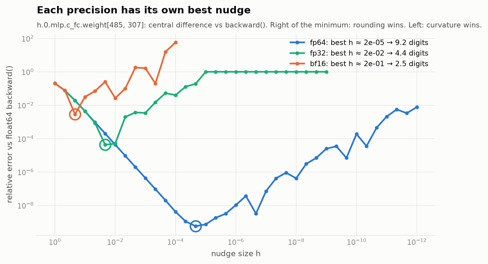</p>

**How small should the nudge be?** Every precision has a V: too large and curvature pollutes the slope (∝ h²), too small and `L(w+h) − L(w−h)` cancels catastrophically (∝ ε/h). fp64 bottoms out at **9.2 digits** (h ≈ 2e-05), fp32 at **4.4**, bf16 at **2.5** — bf16 can't even measure its own gradients.

**"If they do not agree, you have found something worth understanding."**

| planted failure | `backward()` | nudge | ratio |
|---|--:|--:|--:|
| dropout 0.1, fresh mask per forward | +0.02000322 | +1487.69016004 | **0.000013** |
| dropout 0.1, mask re-seeded (repeatable) | +0.02000322 | +0.02000322 | **1.000000** |
| no zero_grad between two backward() | +0.05464826 | +0.02732413 | **2.000000** |

- **Dropout** draws a new mask every forward, so `L(w+h)` and `L(w−h)` come from different networks. Re-seed and agreement returns exactly. This is the reason the lesson gives for V4 using **dropout = 0 in its reversible models**: a reversible backward recomputes the forward and needs it repeatable.
- **No `zero_grad`**: gradients accumulate, so `.grad` is exactly 2× the truth. It doesn't crash, and the loss still falls.
- **The one I didn't plant.** My first gradient check reported only ~6 agreeing digits in "float64". The cause: `token_loss` called `logits.float()`, silently downcasting the float64 model to fp32 inside the loss. The gradient check found a precision bug in the code doing the checking. Fixed: upcast-only.

---

## 3 · Breaking gradient accumulation on purpose

Each optimizer step gathers 4 micro-batches whose sequences have **different lengths** (16 – 256 tokens). Three loops see byte-identical data, initial weights and RNG, all in fp32:

- **big batch**: everything padded into one batch, with `ignore_index` masking — the ground truth;
- **correct**: each micro-batch's `sum(token losses) / tokens in the whole step`;
- **broken**: `mean(token losses) / K` — the average of the averages, the bug that lived in major frameworks until 2024.

<p align="center">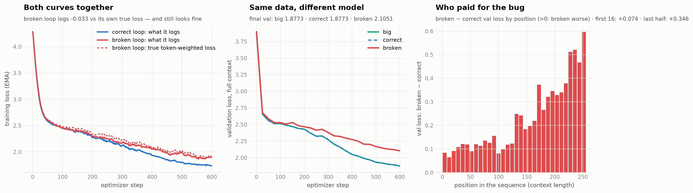</p>

- **Correct = big batch.** Max gradient difference **3.0e-08**, cosine 1.00000000, identical validation curves (both end at **1.8773**).
- **Broken is a different model.** Its gradient points elsewhere (cosine **0.789** on a typical step) and it ends at **2.1051**, worse by **+0.228** nats on the same data and compute.
- **Who pays.** A short micro-batch holds a few % of the tokens but gets 25% of the vote, so the optimizer over-serves *short-context* prediction. Per position, the broken model is worse by +0.074 on the first 16 positions but by **+0.346** on the second half of the context: long-range modelling is what it gave up.
- **Its own curve looked fine.** The broken loop's logged loss is off its own true token-weighted loss by -0.033. Nothing in the curve says anything is wrong.

<p align="center">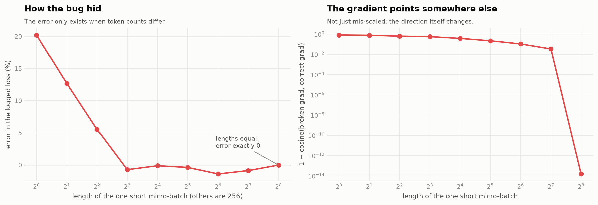</p>

**How it hid.** Three micro-batches at 256 tokens and one at length ℓ, from trained weights:

| short micro-batch ℓ | its token share | its vote | logged-loss error | grad cosine to correct |
|--:|--:|--:|--:|--:|
| 1 | 0.1% | 25% | +20.22% | 0.1925 |
| 2 | 0.3% | 25% | +12.69% | 0.2392 |
| 4 | 0.5% | 25% | +5.55% | 0.3771 |
| 8 | 1.0% | 25% | -0.72% | 0.4399 |
| 16 | 2.0% | 25% | -0.11% | 0.6284 |
| 32 | 4.0% | 25% | -0.37% | 0.7831 |
| 64 | 7.7% | 25% | -1.39% | 0.8947 |
| 128 | 14.3% | 25% | -0.86% | 0.9661 |
| 256 | 25.0% | 25% | +0.00% | 1.0000 |

At ℓ = 256 the error is **exactly zero** and the cosine exactly 1. Testing on equal-length batches, which is how most code gets tested, can never reveal the bug.

---

## 4 · The grad norm, at every step

The main run logs, every step: training loss, **pre-clip** grad norm (measured *after* un-scaling — an fp16 scaled gradient reports the loss scale, not the gradient), the norm of every layer group, the loss scale, tokens/s, and a **probe loss**: the current weights scored on one fixed validation batch *before* each update.

<p align="center">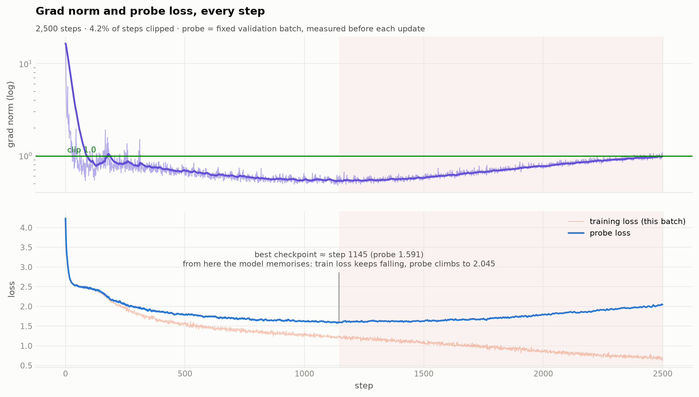</p>

**A silent failure nobody planted.** The training loss falls all the way to 0.69. The probe bottoms out at **1.591 around step 1145** and climbs back to **2.045**: the model starts memorising Shakespeare instead of learning to write it, and the grad norm rises with it. A dashboard showing only the training loss would ship the worst checkpoint of the run.

### One step where the norm moved first

<p align="center">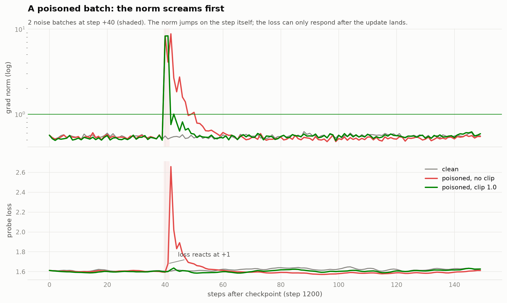</p>

From a checkpoint at step 1200, three continuations see the same clean data; in two, steps +40 and +41 are replaced by noise.

| run | grad norm at the poisoned step | probe loss first moves | peak extra loss |
|---|--:|--:|--:|
| poisoned, **no clip** | **8.31** (typical ≈ 0.54) | step +41 — **one step after the norm** | **+1.051** |
| poisoned, **clip 1.0** | 8.28 → clipped to 1.0 | step +43, barely | +0.025 |

The norm reports the bad data on the step it arrives, because it is computed from that batch *before* the update. The loss can only move once the update has landed.

### …and when it doesn't

<p align="center">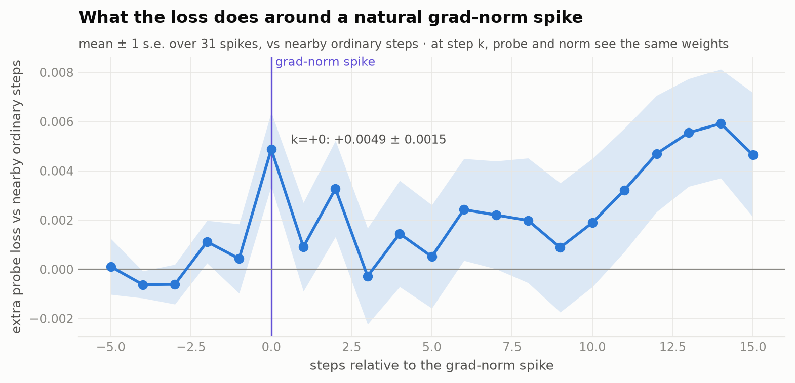</p>

Averaging the probe loss around all **31 natural grad-norm spikes** in the main run (against nearby ordinary steps) shows a real loss bump — but it is already there **at k = +0** (+0.0049 ± 0.0015), *with* the norm, not after it. At step k the probe and the norm are measured on the **same weights**, so when the cause (a slightly bad previous update) is already in the weights, both instruments see it at once. The precise version of the lesson's claim:

> **The grad norm moves *before* the loss when trouble arrives with the data, and *with* the loss when it is already in the weights. It is never later, and it is much louder.**

<p align="center">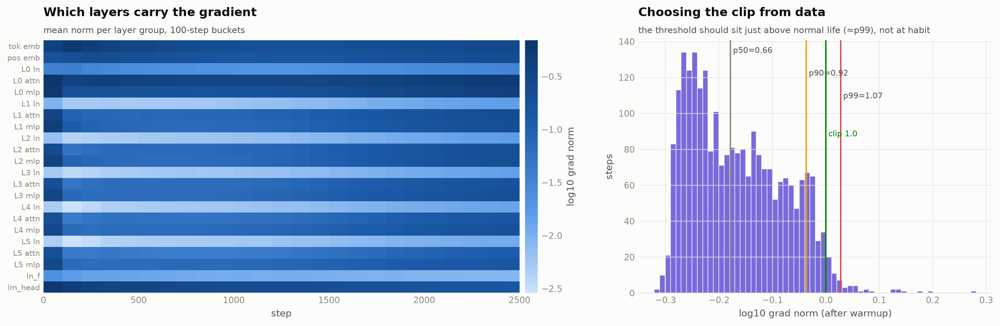</p>

**Choosing the clip from data, not habit** (one of the lesson's open questions for V5). After warmup the norm's p50 / p90 / p99 are **0.66 / 0.92 / 1.07**. A cap of 1.0 sits right at p99 — it clipped 4.2% of steps, mostly in warmup and the overfitting tail. A cap at 1.5 × p99 ≈ **1.60** would leave normal training untouched while still sitting far below a poisoned step's 8.3. The heatmap shows where the gradient lives: the embeddings, layer-0 attention/MLP and the output head carry the most, and LayerNorm gains the least.

---

## 5 · MFU, measured honestly

`MFU = 6 · N · tokens/s ÷ dense tensor-core peak`. N counts the matmul weights; I also report the PaLM form `6N + 12·L·T·C`, because at T = 256 attention is a real share of the work that `6N` ignores. Peak is the datasheet's dense fp16/bf16 tensor-core number: the machine we're paying for.

<p align="center">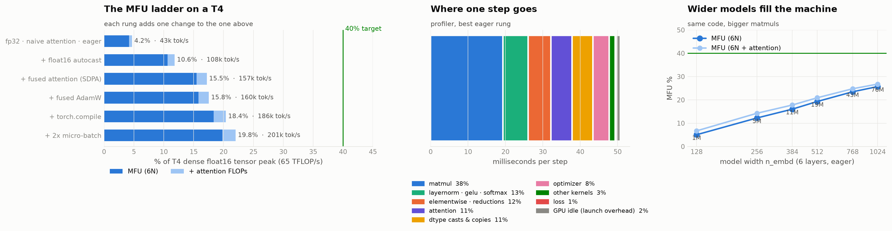</p>

| rung (each adds one change) | T4 tok/s | T4 MFU | A100 tok/s | A100 MFU |
|---|--:|--:|--:|--:|
| fp32 · naive attention · eager | 43k | **4.2%** | 164k | **3.4%** |
| + float16 autocast | 108k | **10.6%** | 485k | **10.0%** |
| + fused attention (SDPA) | 157k | **15.5%** | 720k | **14.8%** |
| + fused AdamW | 160k | **15.8%** | 764k | **15.7%** |
| + torch.compile | 186k | **18.4%** | 1,015k | **20.8%** |
| + 2x micro-batch | 201k | **19.8%** | 1,291k | **26.5%** |

<p align="center">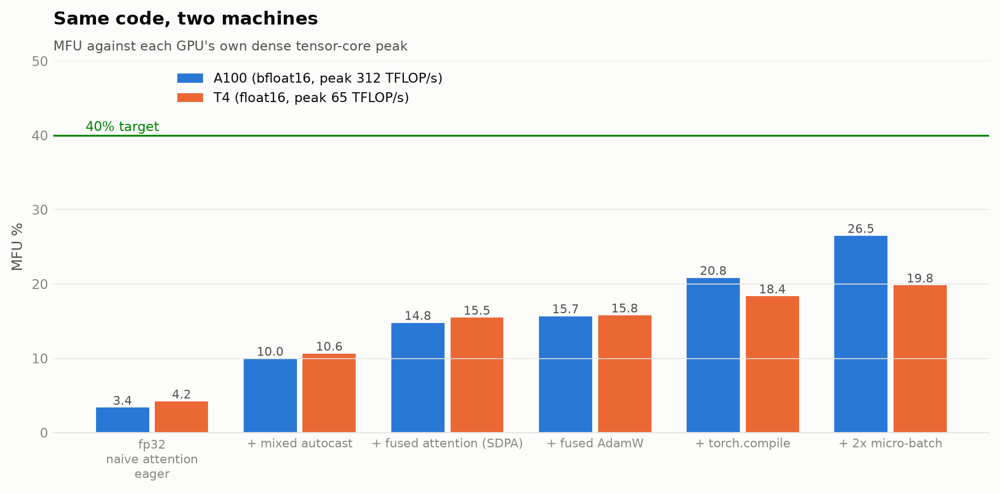</p>

### What is costing the distance to 40%

- **Headline:** best rung `+ 2x micro-batch` reaches **19.8% MFU** (12.9 TFLOP/s of 65); counting attention FLOPs, 22.0%. The fp32 starting point was 4.2% — a 4.7× speed-up with the same maths.
- **The ceiling is not the datasheet.** A large square float16 matmul — the best case — sustains 24.8 TFLOP/s = **38% of peak**. A T4 is a 70 W card that cannot hold its boost clock under sustained load, so 40% of the datasheet is **105% of what this card sustains even on a perfect matmul**: the target sits at or above what the hardware can actually deliver. Measured against that practical ceiling, the best rung is at **52%**.
- **Our matmuls are too small to fill it.** At this model's shapes (C=384) the same matmuls run at 17.4–25.1 TFLOP/s (27%–39% of peak): too few columns per tile to keep the tensor cores fed.
- **Most of a step is not matmul.** The profiler puts matmuls at **38%** of the step; LayerNorm, GELU, softmax, the loss, the optimizer and plain elementwise kernels are memory-bound — they move bytes, not FLOPs — and the GPU is busy 98% of the wall clock, so launch overhead is not the problem here: the kernels themselves are.
- **Size fixes a lot of it.** With identical code, MFU goes from 5.1% at n_embd=128 to 25.7% at n_embd=1024. The distance to 40% is mostly the price of a 10M-parameter model, then the GPU class.
- **The GPU generation.** Turing has no bf16 tensor cores (so we pay for fp16 + loss scaling), and FlashAttention-2 needs Ampere; SDPA falls back to the memory-efficient kernel.
- **Not counted in 6N at all:** the optimizer step, clipping, the probe/eval passes, and recomputation. MFU is deliberately strict — "useful model FLOPs" only.

**Where the milliseconds go** (T4, best eager rung; wall time measured *without* the profiler attached, which would otherwise slow the Python side ~4× and fake a large idle share — a mistake I made on the first run):

| bucket | ms / step | share |
|---|--:|--:|
| matmul | 19.3 | 38% |
| layernorm · gelu · softmax | 6.7 | 13% |
| elementwise · reductions | 6.1 | 12% |
| attention | 5.7 | 11% |
| dtype casts & copies | 5.6 | 11% |
| optimizer | 4.3 | 8% |
| other kernels | 1.6 | 3% |
| GPU idle (launch overhead) | 1.1 | 2% |
| loss | 0.3 | 1% |

**Model size is the biggest lever** (same code, 6 layers, eager):

| n_embd | params | T4 MFU | A100 MFU |
|--:|--:|--:|--:|
| 128 | 1.2M | 5.1% | 1.2% |
| 256 | 4.8M | 12.2% | 5.5% |
| 384 | 10.7M | 16.0% | 12.5% |
| 512 | 18.9M | 19.3% | 21.4% |
| 768 | 42.6M | 23.5% | 31.4% |
| 1024 | 75.6M | 25.7% | 37.0% |

**Honest bottom line.** 19.8% on the T4 is about **52% of what this card sustains on a perfect matmul**. The remaining gap is, in order: a model too narrow to fill the tensor cores (C = 384 matmuls run at 17–25 TFLOP/s), memory-bound non-matmul kernels (LayerNorm, GELU, softmax, autocast's dtype casts, the optimizer) taking most of the step, and a GPU generation without bf16 or FlashAttention-2. Launch overhead is *not* it on the T4 (the GPU is busy 98% of the time), but it is on the much faster A100 (13% idle), which is exactly where `torch.compile` and CUDA graphs pay off.

---

## 6 · The number 0.1, by hand

**Step 1 — binary.** Doubling the fraction and taking the integer part each time: `0.1 → 0.2 → 0.4 → 0.8 → 1.6 → 1.2 → 0.4 → …` gives `0.000110011001100…₂`, so

$$0.1 = 1.\underbrace{1001\,1001\,1001\ldots}_{\text{mantissa, never ends}} \times 2^{-4}$$

Every format stores **sign 0**, **true exponent −4**, and as much of `1001 1001…` as fits, **rounded to nearest-even**. The digit after every cut is `1` followed by non-zero bits, so every format rounds **up**.

| | fp32 (1·8·23, bias 127) | bf16 (1·8·7, bias 127) | fp8 E4M3 (1·4·3, bias 7) |
|---|---|---|---|
| exponent field | −4 + 127 = 123 = `01111011` | −4 + 127 = 123 = `01111011` | −4 + 7 = 3 = `0011` |
| mantissa, cut | `10011001100110011001100│1100…` | `1001100│1100…` | `100│1100…` |
| rounded | `10011001100110011001101` | `1001101` (= 77) | `101` (= 5) |
| **bits** | **`0 01111011 10011001100110011001101`** | **`0 01111011 1001101`** | **`0 0011 101`** |
| hex | `0x3DCCCCCD` | `0x3DCD` | `0x1D` |
| value | 13421773 / 2²⁷ = **0.100000001490116…** | 205 / 2048 = **0.10009765625** | 13 / 128 = **0.1015625** |
| error | +1.5 × 10⁻⁸ relative | +9.8 × 10⁻⁴ (0.098%) | +1.6 × 10⁻² (**1.56%**) |

<p align="center">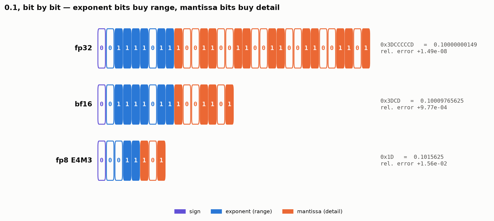</p>

**Checked against hardware** (`struct.pack('>f')`, `torch.bfloat16`, `torch.float8_e4m3fn`): all three **match bit-for-bit**. The same exact-rational encoder covers fp16 and E5M2 too:

| format | layout | bits | hex | stored value | rel. error |
|---|---|---|---|---|--:|
| fp32 | 1·8·23 | `0 01111011 10011001100110011001101` | `0x3DCCCCCD` | 0.10000000149 | +1.49e-08 |
| fp16 | 1·5·10 | `0 01011 1001100110` | `0x2E66` | 0.0999755859375 | -2.44e-04 |
| bf16 | 1·8·7 | `0 01111011 1001101` | `0x3DCD` | 0.10009765625 | +9.77e-04 |
| fp8 E4M3 | 1·4·3 | `0 0011 101` | `0x1D` | 0.1015625 | +1.56e-02 |
| fp8 E5M2 | 1·5·2 | `0 01011 10` | `0x2E` | 0.09375 | -6.25e-02 |

<p align="center">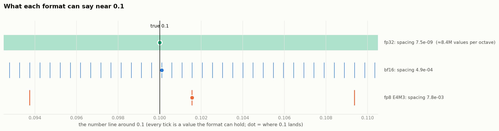</p>

Near 0.1, E4M3 can say **0.09375, 0.1015625, 0.109375** and nothing in between.

### Why it matters: update swamping, and the fp32 master copy

<p align="center">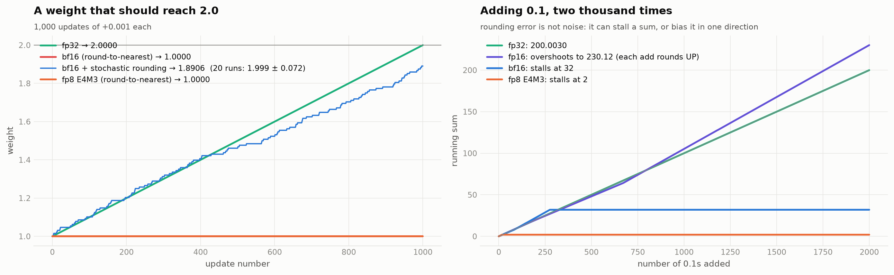</p>

- A weight at 1.0 receives +0.001 a thousand times. fp32 → **2.0000**. **bf16 → 1.0000**: the gap above 1.0 is 2⁻⁷ ≈ 0.0078, so each update is under half a gap and rounds straight back. Every single one. This is why the lesson's 16 bytes/weight include a **4-byte fp32 master copy**.
- **Stochastic rounding** fixes it *on average*: 20 runs give **1.999 ± 0.072**. That's how low-precision recipes get by without a master copy.
- Summing 0.1 two thousand times: bf16 **stalls at 32**, E4M3 **at 2**, and fp16 **overshoots to 230.12**, because between 64 and 128 every `+0.1` rounds *up* to `+0.125`. Rounding error is not noise: it can stall or bias.

### fp16 underflow, on this model's real gradients

<p align="center">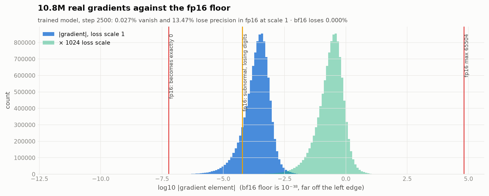</p>

| loss scale | fp16: becomes 0 | fp16: subnormal (losing digits) | fp16: overflow | bf16: becomes 0 |
|---|--:|--:|--:|--:|
| 1 | 0.027% | 13.47% | 0.000% | 0.000% |
| 1,024 | 0.004% | 0.03% | 0.000% | 0.000% |
| 65,536 | 0.000% | 0.02% | 0.000% | 0.000% |

At scale 1, **13.5% of real gradient elements** land in fp16's subnormal range and 0.027% vanish; ×1024 rescues nearly all of them, and bf16 loses none at any scale.

### Which one would I train in?

**bf16 for compute, fp32 for master weights and optimizer state, and fp8 E4M3 for the big matmuls only on hardware that does it natively, with per-block scales.**

- **Not fp32 compute.** Its 7.2 digits are drowned by gradient noise anyway, at 2× the memory traffic and a fraction of tensor-core speed (§5: fp32 is the bottom rung of the ladder).
- **bf16** keeps fp32's exponent, so the histogram above has nothing to fear and there's no loss scale to tune. Its 2.4 digits are fine for activations and gradients, but **not for accumulating updates into weights**, which is what the swamping plot shows. Hence the fp32 master copy.
- **fp8 E4M3** misses 0.1 by 1.56% and has nothing between 0.094 and 0.109. That's acceptable for matmul *inputs* when every block carries its own scale (the 2026 production recipe), and unacceptable for anything that accumulates: weights, optimizer moments, softmax, the loss, LayerNorm reductions.
- **On this T4 specifically:** fp16 + dynamic loss scaling, because Turing has no bf16 tensor cores. The underflow table and the GradScaler trace (notebook) show what that costs.

---

## What this run says about the lesson's open questions for V5

| question | evidence from this repo |
|---|---|
| **What precision?** | bf16 compute + fp32 master (§6 swamping, underflow). fp8 only for matmul inputs with block scales. |
| **What clip threshold?** | Pick it from the norm distribution after warmup: here p99 ≈ 1.07, so a cap of ~1.5 × p99 leaves normal steps alone and still catches a poisoned batch. Log the norm from step one. |
| **What MFU to accept?** | Decide it against the card's *practical* ceiling, not the datasheet: on a T4 a perfect matmul only reaches 38%. Set the number before the run. |
| **Normalise the loss how?** | By token, never by micro-batch (§3): the alternative silently trades long-context quality for short. |

---

## Repository

```
training_loop.ipynb        the executed notebook (T4 run): every section above, with outputs
figures/                   every figure in this README
results/                   summary.json, main_run.json (per-step logs), mfu_T4.json, mfu_A100.json
docs/index.html            the interactive companion page (GitHub Pages)
tools/notebook_cells.md    notebook source (cells as markdown/code blocks; tags pick sections)
tools/build_notebook.py    builds training_loop.ipynb from the source
tools/run_notebook.py      headless execution (profiles: quick / full / mfu)
tools/modal_app.py         runs it on Modal T4 + A100 and pulls the results back
tools/make_readme.py       writes this README from results/*.json
```
